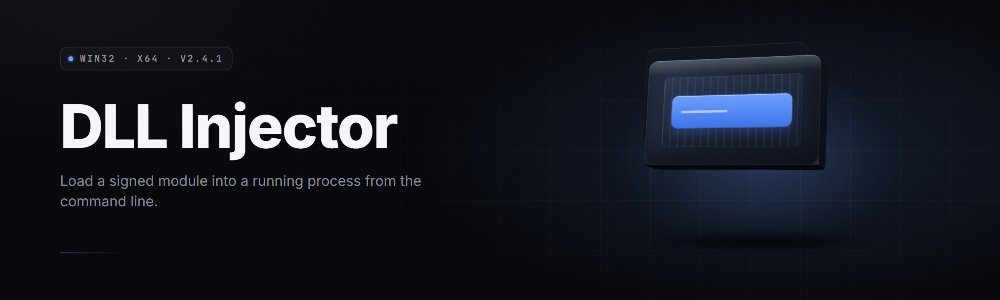

  
  
  

  

  
  
  

---

**A modular Windows DLL Injector suite for manual mapping, thread hijacking, and process-side library loading.**

---

## 📑 Table of Contents

- [Overview](#-overview)
- [What is a DLL Injector](#-what-is-a-dll-injector)
- [All Modules Status](#-all-modules-status)
- [Key Features](#-key-features)
- [Quick Start](#-quick-start)
- [Compatibility](#-compatibility)
- [System Requirements](#-system-requirements)
- [Injection Methods](#-injection-methods)
- [The Problem](#-the-problem)
- [The Solution](#-the-solution)
- [Comparison](#-comparison)
- [Installation](#-installation)
- [Known Issues](#-known-issues)
- [FAQ](#-faq)
- [Troubleshooting Flow](#-troubleshooting-flow)

---

## 🧭 Overview

| Category | Details |
|---|---|
| Product | DLL Injector Toolkit — Pro Release 2026 |
| Distribution | Portable `.exe` — no installer, no runtime deps |
| Target OS | Windows 10 (1809+) and Windows 11 (21H2+) |
| Architecture | x64 native, x86 target support via WOW64 bridge |
| Injection Backend | 9 distinct methods, all selectable at runtime |
| Config Format | TOML profile per target — hot-reloadable |
| Logging | Structured JSONL + human console tail |
| Extensibility | Plugin DLLs loaded from `plugins/` at boot |

DLL Injector Toolkit is a single-binary Windows application built for loaders, modders, red-teamers, and reversers who need deterministic, repeatable DLL injection into live processes. It ships nine injection backends, a manual mapper, a module scanner, and a profile system so the same target can be re-injected with a single hotkey. Every backend is exposed through one UI and one CLI — no recompilation, no per-method toolchains.

---

## 🧩 What is a DLL Injector

| Term | Explanation |
|---|---|
| DLL Injector | A program that forces a target process to load an arbitrary `.dll` at runtime, without the target asking for it |
| Manual Mapping | Copying a DLL image into the target's memory and resolving imports/relocations yourself instead of calling `LoadLibrary` |
| Thread Hijacking | Suspending a target thread, redirecting its instruction pointer to a stub, then resuming |
| APC Injection | Queueing an Asynchronous Procedure Call on a target thread so it runs your loader stub on next alertable wait |
| SetWindowsHookEx | Installing a system-wide hook that causes the OS to map your DLL into every matching process |
| Reflective Loading | A DLL that maps itself with no loader stub and no `LoadLibrary` call, resolving its own imports |
| Handle | A kernel object reference (process, thread, section) — the injector needs `PROCESS_VM_WRITE`, `PROCESS_VM_OPERATION`, `PROCESS_CREATE_THREAD` at minimum |
| Module Scanner | Enumerates loaded modules in a target via PEB walk, bypassing the toolhelp snapshot API |

**Why people reach for one:**

- Load mods, cheats, overlays, and instrumentation into a live target without patching the executable on disk.
- Hook internal functions to observe behavior the target never exposes.
- Swap implementations at runtime for testing, fuzzing, or feature toggling.
- Reverse-engineer closed-source binaries by attaching a debug DLL.
- Run a plugin sandbox inside a host process that has no plugin API.
- Ship a single `.exe` that works across games, apps, and services without per-target build steps.

---

## ✅ All Modules Status

| Module | Status | Description |
|---|---|---|
| `classic_loadlibrary` | ✅ Working | `CreateRemoteThread` + `LoadLibraryW` — the baseline backend |
| `manual_mapper` | ✅ Working | Full PE image mapping with reloc, import, TLS handling |
| `thread_hijack` | ✅ Working | Suspend/redirect/resume via `SetThreadContext` |
| `apc_injector` | ✅ Working | `QueueUserAPC` on alertable threads, multi-thread fanout |
| `hook_injector` | ✅ Working | `SetWindowsHookEx` with per-process module fanout |
| `reflective_loader` | ✅ Working | Self-mapping DLL stub shipped in `stubs/reflective.bin` |
| `module_scanner` | ✅ Working | PEB `Ldr` walk + manual export/import resolution |
| `handle_elevator` | ✅ Working | Auto-retry with `SeDebugPrivilege` and token duplication |
| `process_browser` | ✅ Working | Live process tree with arch, session, integrity detection |
| `profile_engine` | ✅ Working | TOML profiles per target, hotkey binding, hot-reload |
| `pe_parser` | ✅ Working | Zero-dependency PE32/PE32+ reader with section map |
| `import_resolver` | ✅ Working | IAT fixup with ordinal + name resolution |
| `reloc_applier` | ✅ Working | Base relocation table walker for manual map |
| `tls_callback_runner` | ✅ Working | Runs TLS callbacks post-map in correct order |
| `exception_handler_setup` | ✅ Working | Installs SEH/VEH entries for mapped image |
| `delay_import_resolver` | ✅ Working | Resolves delay-loaded imports on first access |
| `export_forwarder` | ✅ Working | Handles forwarded exports in target modules |
| `section_mapper` | ✅ Working | Maps `.text`, `.data`, `.rdata` with correct protections |
| `entry_point_caller` | ✅ Working | Calls `DllMain` with `DLL_PROCESS_ATTACH` in target context |
| `unload_engine` | ✅ Working | Calls `FreeLibrary` / unmaps manual images cleanly |
| `signature_scanner` | ✅ Working | AOB scanning with wildcard + mask support |
| `pattern_cache` | ✅ Working | Caches scan results per target module across runs |
| `driver_probe` | ✅ Working | Detects loaded anti-cheat kernel drivers by name |
| `integrity_checker` | ✅ Working | Pre-inject sanity check on target PE headers |
| `delay_scheduler` | ✅ Working | Timed / event-triggered injection queue |
| `hotkey_daemon` | ✅ Working | Global hotkeys bound to profiles via `RegisterHotKey` |
| `crash_guard` | ✅ Working | Watchdog thread that detaches on target exception |
| `log_writer` | ✅ Working | Structured JSONL log with rotation |
| `config_linter` | ✅ Working | Validates profile TOML before injection |
| `update_checker` | ✅ Working | Manual update check against release channel |
| `plugin_host` | ✅ Working | Loads user DLLs from `plugins/` at boot |

---

## 🎯 Key Features

| Feature | Description | Benefit |
|---|---|---|
| Nine injection backends | Classic, manual map, hijack, APC, hook, reflective, and more | One tool covers every scenario |
| Runtime method switch | Change backend without restarting the injector | Faster iteration on stubborn targets |
| Manual mapper | Full PE mapping with reloc, imports, TLS, SEH | No `LoadLibrary` footprint in target |
| Profile engine | TOML per target, hotkey bound, hot-reloadable | Repeatable, scriptable workflows |
| PEB module scanner | Enumerates modules without toolhelp snapshot | Sees modules that hide from `CreateToolhelp32Snapshot` |
| Structured logging | JSONL output with rotation | Post-mortem analysis without guesswork |
| Plugin host | User DLLs loaded from `plugins/` at boot | Extend without forking the repo |
| Crash guard | Watchdog detaches on target exception | Target survives a bad injection |
| CLI + GUI | Same engine, both frontends | Batch scripts and manual use |
| Delay scheduler | Timed or event-triggered injection | Hit the target at the right moment |
| Token elevator | Auto `SeDebugPrivilege` + token dup | Handles protected targets cleanly |
| Config linter | Validates profiles before injection | No half-injected runs from typos |

### **Process Targeting** — selection and discovery

| Feature | Effect |
|---|---|
| Live process tree | Refreshes at 2 Hz, shows arch, session, integrity |
| Filter by name / PID / window title | Narrows the list fast on busy systems |
| Session isolation view | Separates your session from services and other users |
| Protected-process flag | Marks targets that need `SeDebugPrivilege` |

### **Module Management** — post-injection visibility

| Feature | Effect |
|---|---|
| Loaded module list | PEB walk, bypasses snapshot API |
| Export browser | Names, ordinals, forwarded exports |
| Unload engine | Clean `FreeLibrary` or manual unmap |
| Signature scanner | AOB scan with wildcards and masks |

### **Safety & Recovery** — keeping the target alive

| Feature | Effect |
|---|---|
| Crash guard watchdog | Detaches on target exception, no cascade |
| Integrity checker | Aborts injection if target headers look tampered |
| Dry-run mode | Simulates injection without writing memory |
| Rollback log | Records every write for manual revert |

---

  

---

## 🚀 Quick Start

1. 📦 **Visit the project page** and grab the latest `dll-injector-toolkit` release archive.
2. 🗂️ **Extract** the archive to any folder — no installer, no PATH changes, no runtime deps.
3. 🖱️ **Run** the `.exe` as Administrator (required for cross-process memory access on most targets).
4. 🎯 **Select a target** in the process browser, pick an injection method, and point it at your `.dll`.
5. 🧪 **Verify** with the module scanner — your DLL should appear in the loaded module list within a second.

---

## 🖥️ Compatibility

| Platform | Support Level | Notes |
|---|---|---|
| Windows 11 23H2+ | Full | Native x64 injection, WOW64 bridge for x86 targets |
| Windows 11 21H2–22H2 | Full | All backends verified |
| Windows 10 21H2+ | Full | All backends verified |
| Windows 10 1809–20H2 | Supported | Hook injector may need manual thread targeting |
| Windows Server 2019/2022 | Supported | Service session injection works with `SeDebugPrivilege` |
| Windows 8.1 | Partial | Manual map works, hook injector untested |
| Wine / Proton | Experimental | Classic backend only, no driver probe |

---

## ⚙️ System Requirements

| Component | Minimum | Recommended |
|---|---|---|
| OS | Windows 10 1809 (x64) | Windows 11 23H2 (x64) |
| CPU | Dual-core 1.8 GHz | Quad-core 2.8 GHz+ |
| RAM | 2 GB free | 8 GB free |
| Disk | 40 MB for the toolkit | 250 MB with logs and profiles |
| Runtime | None (statically linked) | None |
| Privileges | Local admin | Local admin + `SeDebugPrivilege` |
| Display | 1280×720 | 1920×1080 |

---

## 🧪 Injection Methods

Each method below is a selectable backend in the toolkit. Choose based on target protection, thread state, and whether you need a persistent module or a one-shot map.

- **Classic (`CreateRemoteThread` + `LoadLibraryW`)** — fastest, most compatible, leaves a visible module entry.
- **Manual Mapping** — no `LoadLibrary`, no module entry, full PE image copy with reloc + imports + TLS.
- **Thread Hijacking** — suspends a live thread, redirects RIP to a stub, resumes; works when remote thread creation is blocked.
- **APC Injection** — queues a loader on alertable threads; stealthy but requires an alertable wait.
- **`SetWindowsHookEx`** — OS maps your DLL into matching processes; useful for fanout, limited to hook-compatible targets.
- **Reflective Loading** — self-mapping stub DLL; no loader on the injector side, most self-contained.
- **Section Mapping** — maps a shared section into the target; useful for large payloads.
- **Delay-Load Resolver** — resolves imports on first access instead of at map time.
- **Export Forwarder** — handles forwarded exports so callers don't break.

---

## 🧱 The Problem

- Most injectors ship **one backend** and break the moment the target blocks remote thread creation.
- Manual mappers are usually **separate tools** with their own CLI, config format, and quirks.
- Profile systems are rare — every injection is retyped from scratch.
- Module scanning hides behind `CreateToolhelp32Snapshot`, which misses PEB-only modules.
- Bad injections **take the target down** with no rollback and no watchdog.
- Logging is a single text file with no structure, no rotation, no timestamps you can trust.
- Extending the tool means forking the repo and recompiling.

---

## 🛠️ The Solution

| Problem | Solution |
|---|---|
| Single-backend injectors | Nine backends selectable at runtime, all in one binary |
| Separate mapper tools | Manual mapper built in as a first-class backend |
| Retyped injections | TOML profiles per target, hotkey-bound, hot-reloadable |
| Snapshot-only module view | PEB `Ldr` walk that sees hidden modules |
| Crashed targets | Crash guard watchdog detaches on exception |
| Unstructured logs | JSONL with rotation and timestamps |
| Fork-to-extend | Plugin host loads DLLs from `plugins/` at boot |

---

## ⚖️ Comparison

| Aspect | Alternative | This Tool |
|---|---|---|
| Backends | 1–2 per tool | 9, runtime-selectable |
| Manual mapper | Separate binary | Built in |
| Profiles | None | TOML per target, hot-reloadable |
| Module scan | Toolhelp snapshot | PEB walk |
| Crash recovery | None | Watchdog detach |
| Logging | Plain text | Structured JSONL |
| Extensibility | Fork and rebuild | Plugin DLLs at boot |
| Frontends | GUI or CLI | Both, same engine |

---

## 📥 Installation

1. **Download** — Grab the release archive from the project page. Pick `x64` for modern Windows, or the `x86` build only if your target is 32-bit and you can't use the WOW64 bridge.
2. **Extract** — Unzip anywhere. The toolkit is portable; no registry writes, no service install, no PATH edits.
3. **Run** — Right-click the `.exe` and choose *Run as administrator*. On first launch it creates `profiles/`, `logs/`, and `plugins/` next to the binary.

---

## 🩹 Known Issues

| Issue | Solution |
|---|---|
| Hook injector does nothing on some targets | Target has no hookable window message; switch to thread hijack or manual map |
| Manual map fails with `STATUS_INVALID_IMAGE_FORMAT` | DLL is packed or has an unusual section layout; check the integrity checker output |
| APC injection silently no-ops | No alertable thread in the target; use a different backend |
| Target crashes immediately after injection | Enable dry-run to confirm the DLL itself isn't the problem; check `logs/` |
| Process browser shows no elevated targets | `SeDebugPrivilege` wasn't granted; re-run as admin |
| Plugin DLLs don't load | Check ABI — plugins must export `dllit_plugin_init` |

---

## ❓ FAQ

| Question | Answer |
|---|---|
| Does this need Python or .NET? | No. It's a single statically linked `.exe`. |
| Can I inject into protected processes? | With admin + `SeDebugPrivilege` you can reach most targets; kernel-protected ones need a driver and are out of scope. |
| Which backend should I start with? | Classic for compatibility, manual map for stealth. |
| Does it work on 32-bit targets? | Yes, via the WOW64 bridge, or with the `x86` build. |
| Can I script injections? | Yes — the CLI mirrors the GUI and reads the same TOML profiles. |
| Does it leave traces in the target? | Classic leaves a module entry; manual map does not. |
| Where are logs stored? | `logs/` next to the binary, JSONL format, rotated at 10 MB. |
| Can I extend it? | Drop a DLL exporting `dllit_plugin_init` into `plugins/`. |
| Will it work on Steam games? | Depends on the game's anti-cheat. Driver-probe will warn you. |
| Is there a portable version? | The whole toolkit is portable by design. |

---

## 🧯 Troubleshooting Flow

1. **Injection fails silently** → check `logs/latest.jsonl` for the last error code.
2. **Access denied** → confirm admin, then confirm target integrity level in the process browser.
3. **Target crashes** → enable dry-run, re-inject, inspect the rollback log.
4. **DLL doesn't appear** → run the module scanner; if it's missing, the entry point likely returned `FALSE`.
5. **Hook backend no-ops** → switch to thread hijack; the target has no hookable message pump.

---

The toolkit is built around one idea: a single binary that can inject into almost anything, with the method chosen at runtime instead of at compile time. Profiles, structured logging, and the crash guard exist so that a bad run costs you a log entry, not a target. If you find a backend that fails on a target the others don't, the plugin host is the fastest path to a fix without waiting on a release.

  

